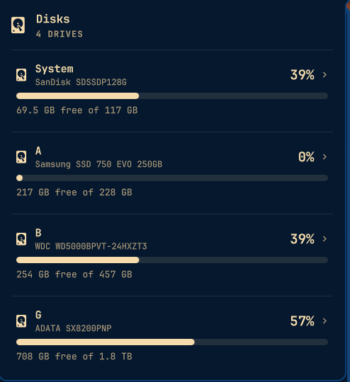
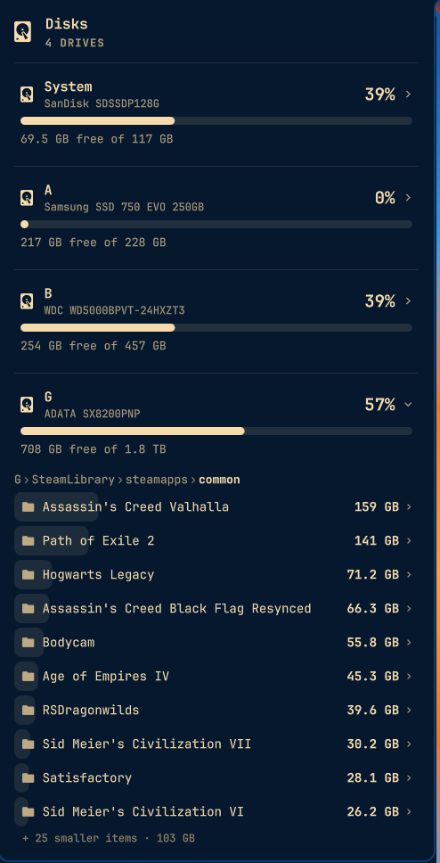

# Disks

A "This PC"-style disk usage popup for the [Omarchy](https://omarchy.org/) bar.
Click the drive icon to see how full every drive is at a glance, then click a
drive to find out which folders are taking up the space.

<p>
  
  
</p>

It is strictly **read-only**: there are no buttons that mount, format, delete or
otherwise change anything. It only runs `findmnt`, `lsblk` and `du`.

## Install

```bash
omarchy plugin add https://github.com/Athesias/omarchy-disks-plugin.git --enable
```

Omarchy clones the repo, validates it, and only then installs and enables it.
To place it somewhere specific on the bar:

```bash
omarchy bar move athesias.disks --section right --before omarchy.network
```

## Using it

- **Click the icon** to open the popup. Each mounted drive gets a card with its
  label, disk model, used percentage, a usage bar and "X free of Y".
- **Click a drive** to expand it into its largest folders and files, biggest
  first. A faint bar behind each row shows its share of the current folder.
- **Click a folder** to drill into it. The breadcrumb above the list
  (`G › SteamLibrary › steamapps`) jumps back up to any level.
- `Esc` closes the popup; `Tab` moves to the neighbouring bar panel.

Colors, fonts, corner rounding and spacing all come from the shell's theme
tokens, so it follows whatever Omarchy theme you switch to.

## Settings

Set these on the widget's entry with `omarchy bar set`:

| Key           | Default | What it does                                          |
|---------------|---------|-------------------------------------------------------|
| `folderRows`  | `10`    | Folders listed before the rest fold into "+ N smaller items" |
| `warnPercent` | `90`    | Fill level at which a drive's bar and percentage turn the theme's urgent color |

```bash
omarchy bar set athesias.disks folderRows 15 --json
omarchy bar set athesias.disks warnPercent 85 --json
```

## How it works

`disk-usage.py` is a small helper with two commands:

- `drives` lists mounted block-device filesystems from `findmnt`, groups
  mounts that share a device into one drive, and adds the label, model and
  transport from `lsblk`. Pseudo filesystems and the `/boot` / `/efi`
  partitions are left out.
- `scan <path>` runs `du -x -a -d1` on the folder. Scans run only when you
  expand a drive or open a folder, and results are reused for five minutes.

Drives are only re-read while the popup is open, so the widget does no work in
the background.

### btrfs

On btrfs installs (Omarchy's default) `/home`, `/var/log` and the package cache
are separate subvolumes mounted on the same drive. The helper recognizes those
nested mounts, measures them separately and credits them to the right parent
folder, so the system drive's breakdown includes your home folder.

Because btrfs compresses files, folder totals can add up to more than the
drive's "used" figure: `du` counts files at their uncompressed size.

### Permissions

The helper runs as your user and never asks for elevated rights. Some system
folders (for example `/root` or parts of `/var/lib`) can't be read that way, so
their sizes are undercounted. When that happens the popup says so under the
folder list.

## Requirements

`python3`, `util-linux` (`findmnt`, `lsblk`) and `coreutils` (`du`), all
present on a stock Omarchy install.

## License

MIT
